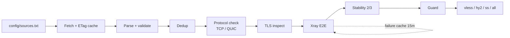

# ⚡ VPN Aggregator

**VLESS · Trojan · Hysteria 2 · Shadowsocks** — автоматический сборщик, валидатор, дедупликатор и E2E-чекер
VPN-конфигов из открытых источников.

[](https://github.com/BarqDev1/vless-aggregator)
[](https://github.com/BarqDev1/vless-aggregator)
[](https://github.com/BarqDev1/vless-aggregator)
[](https://github.com/BarqDev1/vless-aggregator)
[](https://github.com/BarqDev1/vless-aggregator)
[](https://github.com/BarqDev1/vless-aggregator/actions/workflows/update.yml)

> **VMess намеренно исключён.** Shadowsocks поддерживается, но в РФ часто блокируется TSPU.
> Это агрегатор открытых конфигов, а не VPN-сервис: стабильность конкретной ноды не гарантируется.

---

## 🚀 Подписки

Один клиент — **один файл**. Не добавляйте одновременно `all` и `vless`/`hysteria2`/`shadowsocks`:
`all` уже содержит всё, иначе появятся визуальные дубликаты.

| Файл | Протоколы | Для чего |
|---|---|---|
| **`all_universal.txt`** | VLESS + Trojan + Hy2 + SS | Один файл на всё |
| **`vless_universal.txt`** | только VLESS | Балансировщики Remnawave |
| **`hysteria2.txt`** | только Hysteria 2 | UDP/QUIC-ноды |
| **`shadowsocks.txt`** | только Shadowsocks | Там, где SS разрешён |

### Прямые ссылки

```text
https://raw.githubusercontent.com/BarqDev1/vless-aggregator/main/all_universal.txt
https://raw.githubusercontent.com/BarqDev1/vless-aggregator/main/vless_universal.txt
https://raw.githubusercontent.com/BarqDev1/vless-aggregator/main/hysteria2.txt
https://raw.githubusercontent.com/BarqDev1/vless-aggregator/main/shadowsocks.txt
```

### Служебные файлы

```text
https://raw.githubusercontent.com/BarqDev1/vless-aggregator/main/state/stats.json
https://raw.githubusercontent.com/BarqDev1/vless-aggregator/main/state/meta.json
https://raw.githubusercontent.com/BarqDev1/vless-aggregator/main/state/history.json
```

> ⚠️ Если клиент показывает старые ошибки — **удалите подписку и добавьте URL заново**.
> INCY и GitHub raw кешируют ответы. Для сброса кеша можно добавить `?v=20261029`.

---

## ✨ Возможности

- 🌐 **4 протокола:** `vless://`, `trojan://`, `hysteria2://` (`hy2://` → `hysteria2`), `ss://`.
- ✅ **Валидация до проверки:** UUID, Reality `pbk`, пароль Trojan, host/port, метод SS.
- ⚡ **Двухступенчатая проверка:**
  - TCP connect / QUIC v1 handshake;
  - реальный E2E-туннель через **Xray 26** с HTTP-запросом.
- 🔐 **Совместимость с Xray 26 / INCY:** удалены `insecure`/`allowInsecure`;
  самоподписанные TLS-ноды пинятся через `pcs`, Hy2 — через `pinSHA256`;
  plaintext-VLESS не публикуется.
- 🧹 **Чистая подписка:** ровно **1 нода на `протокол + host:port`**; копии UUID/SNI схлопываются.
- 🧱 **Стабильность 2 из 3:** новая нода публикуется после 2 успехов из последних 3.
- 🩺 **Атрибуция источников:** `raw / unique / alive / yield` по каждому источнику.
- 🏥 **Карантин источников:** 5 прогонов с нулём → пауза 2 часа (не удаление).
- ⏱️ **Быстрые прогоны:** E2E-кеш 60 минут, кеш падений 15 минут, ETag/304 для источников.
- 🛡️ **Guard:** не даёт опубликовать пустую или деградировавшую подписку.
- 📊 **Наблюдаемость:** статистика, история прогонов, метаданные, бейджи.
- 🤖 **CI:** ruff, mypy, pytest + coverage, pip-audit, Dependabot, алерты в GitHub Issues.

---

## 🧠 Как это работает



1. **Источники** читаются из `config/sources.txt` (HTTP, base64-подписки, Git-репозитории).
2. **Валидация** отбрасывает битые ссылки, plaintext-VLESS, Reality без `pbk`, SS с плагинами.
3. **Дедупликация** идёт по полному конфигу: протокол, host, port, credentials, SNI, транспорт.
4. **Префильтр:** TCP connect или QUIC handshake.
5. **TLS-инспекция:** CA-valid или self-signed (для `pcs`).
6. **E2E:** Xray поднимает туннель и запрашивает `generate_204`; только `204/200` считается успехом.
7. **Стабильность:** новая нода должна пройти 2 из 3 прогонов.
8. **Guard:** защита от пустой/резко уменьшившейся подписки.
9. **Публикация:** 1 нода на `протокол + host:port`, лимиты на `/24` и домен.

---

## ✅ Что значит «проверенная нода»

| Этап | Проверка | Что подтверждается |
|---|---|---|
| VLESS/Trojan | TCP connect | Порт принимает соединения |
| Hysteria2 | QUIC v1 + ALPN `h3` | UDP/QUIC-сервер отвечает |
| Shadowsocks | TCP connect | Порт принимает соединения |
| TLS | certificate inspection | CA-valid или self-signed + `pcs` |
| **E2E** | Xray-туннель + HTTP | Пароль/UUID/Reality/SS работают, есть выход в интернет |

**Чего E2E не проверяет:** скорость, лимиты трафика, срок жизни ключа, блокировки конкретных сервисов.
Это снимок работоспособности на момент прогона, а не SLA.

### Кеш и стабильность

- успешный E2E — **60 минут**;
- неудачный E2E — **15 минут**;
- полная перепроверка успешной ноды — не чаще раза в час;
- новая нода — **2 успеха из 3**, иначе удерживается;
- старые ноды не теряются из истории при одном падении.

### Почему количество нод меняется

| Причина | Эффект |
|---|---|
| 1 нода на `host:port` | копии UUID/SNI не публикуются |
| `MAX_PER_SUBNET=3` | не больше 3 нод на `/24` |
| `MAX_PER_DOMAIN=10` | не больше 10 нод на домен |
| Stability 2/3 | новые ноды ждут второй успех |
| E2E | мёртвые/несовместимые ноды не публикуются |
| Источники | списки обновляются, ноды умирают |

Актуальные цифры всегда в **`state/stats.json`** и бейджах выше.

---

## 🔐 Совместимость с Xray 26 / INCY 3.7.9+

| Проблема | Решение |
|---|---|
| `allowInsecure has been removed` | `insecure`/`allowInsecure` больше не публикуются |
| Self-signed TLS | `pcs=<sha256>` у VLESS/Trojan |
| Hysteria2 TLS | `pinSHA256=<sha256>` |
| `without TLS/Reality` | plaintext-VLESS отбрасывается |
| Дубликаты в INCY | один файл на клиент; `all` уже содержит `vless` |
| Старые ошибки после обновления | удалить подписку и добавить заново |

Shadowsocks — отдельный файл, потому что в РФ он часто блокируется TSPU.

---

## 🔒 Приватный репозиторий

Если сделать репозиторий приватным, **raw-ссылки перестанут работать**. Для приватного
режима используйте готовый Cloudflare Worker:

- `deploy/cloudflare-worker.js` — прокси с GitHub PAT;
- `deploy/wrangler.toml` — конфиг;
- `deploy/README.md` — пошаговая инструкция.

Клиенты используют:

```text
https://sub.example.com/<SUB_KEY>/all
https://sub.example.com/<SUB_KEY>/vless
https://sub.example.com/<SUB_KEY>/hy2
https://sub.example.com/<SUB_KEY>/ss
```

⚠️ Приватный репозиторий расходует минуты GitHub Actions. При cron раз в 30 минут
лимита 2000 минут/месяц может не хватить — см. `deploy/README.md`.

---

## 📁 Структура проекта

```text
.
├── config/
│   └── sources.txt              # источники
├── src/
│   └── vpn_aggregator/
│       ├── __init__.py
│       ├── __main__.py
│       ├── collector.py
│       └── e2e.py
├── state/                       # состояние (коммитится)
│   ├── stats.json
│   ├── meta.json
│   ├── history.json
│   ├── node_history.json
│   ├── source_health.json
│   └── source_cache.json
├── tests/
├── deploy/                      # Cloudflare Worker для приватного режима
│   ├── cloudflare-worker.js
│   ├── wrangler.toml
│   └── README.md
├── .github/
│   ├── workflows/update.yml
│   └── dependabot.yml
├── vless_universal.txt          # публичные подписки — намеренно в корне,
├── hysteria2.txt                # чтобы старые raw-URL не ломались
├── shadowsocks.txt
└── all_universal.txt
```

---

## 🚀 Локальный запуск

Требуется **Python 3.12+**.

```bash
python -m venv .venv
source .venv/bin/activate

pip install -r requirements.lock -r requirements-dev.txt

# Быстрый режим без E2E
PYTHONPATH=src python -m vpn_aggregator

# Полный E2E (нужен Xray 26)
E2E_VERIFY=1 XRAY_BIN=/path/to/xray \
  PYTHONPATH=src python -m vpn_aggregator

# Проверки
pytest --cov=vpn_aggregator --cov-report=term-missing
mypy src/vpn_aggregator
ruff check .
pip-audit -r requirements.lock
```

Коды возврата:

| Код | Значение |
|---:|---|
| `0` | успех |
| `1` | guard: подписка не опубликована, состояние сохранено |
| `2` | нет источников / валидных нод / E2E-бинарника |

---

## ➕ Как добавить источник

Откройте `config/sources.txt` и добавьте одну ссылку на строку:

```text
# Git-репозиторий (клонируется рекурсивно)
git+https://gitlab.com/.../repo.git

# Raw-файл или подписка (текст или base64)
https://raw.githubusercontent.com/.../list.txt
https://domain.com/sub/token
```

Поддерживаются:

- обычный текст;
- base64-подписки;
- Git-репозитории с `.txt/.md/.yaml`;
- ссылки `vless://`, `trojan://`, `hysteria2://`, `hy2://`, `ss://`.

Строки, начинающиеся с `#`, игнорируются. После изменения GitHub Actions запустит сборку.

### Карантин источников

- источник с нулём живых нод **5 прогонов подряд** → пауза **2 часа**;
- через 2 часа он снова проверяется автоматически;
- ссылка из `sources.txt` **не удаляется**.

Текущее состояние — в `state/source_health.json`.

---

## 📊 Наблюдаемость

| Файл | Что внутри |
|---|---|
| `state/stats.json` | живые ноды, протоколы, latency p50/p90, E2E, источники, cap-статистика |
| `state/meta.json` | `profile-title`, интервал обновления, support/home URL, ссылки |
| `state/history.json` | история прогонов: alive, delta, latency, E2E, held_back |
| `state/node_history.json` | хешированные ID нод, 2/3-стабильность, E2E-кеш |
| `state/source_health.json` | карантин и consecutive_failures |
| `state/source_cache.json` | ETag/Last-Modified и закешированные ссылки |

### Метаданные подписки

GitHub raw **не умеет отдавать HTTP-заголовки**. `state/meta.json` содержит значения для
nginx/Remnawave/своего прокси:

```nginx
add_header profile-title "BarqDev Multi-Protocol VPN";
add_header profile-update-interval 0.5;
add_header support-url "https://github.com/BarqDev1/vless-aggregator/issues";
```

---

## ⚙️ Переменные окружения

<details>
<summary><b>Показать все параметры</b></summary>

| Переменная | По умолчанию | Назначение |
|---|---|---|
| `SOURCES_FILE` | `config/sources.txt` | Источники |
| `VLESS_OUTPUT` | `vless_universal.txt` | Выход VLESS |
| `HY2_OUTPUT` | `hysteria2.txt` | Выход Hysteria2 |
| `SS_OUTPUT` | `shadowsocks.txt` | Выход Shadowsocks |
| `ALL_OUTPUT` | `all_universal.txt` | Выход всех протоколов |
| `STATS_OUTPUT` | `state/stats.json` | Статистика |
| `META_FILE` | `state/meta.json` | Метаданные |
| `HISTORY_FILE` | `state/history.json` | История прогонов |
| `NODE_HISTORY_FILE` | `state/node_history.json` | История нод |
| `SOURCE_HEALTH_FILE` | `state/source_health.json` | Карантин источников |
| `SOURCE_CACHE_FILE` | `state/source_cache.json` | ETag-кеш |
| `PING_TIMEOUT` | `3.0` | Таймаут TCP, сек |
| `QUIC_TIMEOUT` | `5.0` | Таймаут QUIC, сек |
| `CHECK_ATTEMPTS` | `2` | Попыток protocol-check |
| `CONCURRENCY` | `60` | Параллельных protocol-check |
| `FETCH_CONCURRENCY` | `16` | Параллельных загрузок |
| `FETCH_TIMEOUT` | `20.0` | Таймаут источника, сек |
| `FETCH_ATTEMPTS` | `3` | Попыток загрузки |
| `E2E_VERIFY` | `0` | Включить E2E (`1` в CI) |
| `E2E_CONCURRENCY` | `10` | Параллельных Xray-клиентов |
| `E2E_TIMEOUT` | `5.0` | Таймаут E2E-запроса, сек |
| `E2E_CACHE_MINUTES` | `60` | Кеш успешного E2E |
| `E2E_FAILURE_CACHE_MINUTES` | `15` | Кеш неудачного E2E |
| `XRAY_BIN` | `xray` | Путь к Xray |
| `NODE_MIN_RECENT_SUCCESS` | `2` | Успехов для публикации |
| `NODE_RECENT_WINDOW` | `3` | Окно стабильности |
| `NODE_HISTORY_TTL_DAYS` | `30` | Хранение истории нод |
| `MAX_PER_ENDPOINT` | `3` | Вариантов на `host:port` для E2E |
| `PUBLISH_PER_ENDPOINT` | `1` | Публикуется на `host:port` |
| `MAX_PER_SUBNET` | `3` | Нод на `/24` или `/48` |
| `MAX_PER_DOMAIN` | `10` | Нод на домен |
| `MIN_ALIVE` | `10` | Минимум живых нод |
| `MAX_DROP_RATIO` | `0.5` | Guard падения |
| `PROTOCOL_MIN_ALIVE` | `3` | Порог per-protocol guard |
| `PROTOCOL_MAX_DROP` | `0.7` | Падение протокола |
| `SOURCE_FAILURE_THRESHOLD` | `5` | Нулевых прогонов до карантина |
| `SOURCE_QUARANTINE_HOURS` | `2` | Длительность карантина |
| `HISTORY_MAX_RUNS` | `1440` | Записей истории (30 дней) |
| `PROFILE_UPDATE_INTERVAL` | `0.5` | Интервал обновления, часы |
| `BASELINE_RESET` | `0` | Пропустить drop-guard один раз |

</details>

---

## 🤖 CI

**Workflow:** `.github/workflows/update.yml`
**Расписание:** каждые **30 минут** (`*/30 * * * *`), плюс `workflow_dispatch` и изменения `config/sources.txt`.

### Test job

1. `ruff check`
2. `mypy src/vpn_aggregator`
3. `pytest --cov=vpn_aggregator --cov-fail-under=50`
4. `pip-audit -r requirements.lock`

### Update job

1. установка Xray **26.10.21**;
2. `python -m vpn_aggregator`;
3. проверка сгенерированных файлов тестами;
4. коммит подписок и `state/`;
5. при guard-ошибке state всё равно коммитится;
6. при падении создаётся/обновляется GitHub Issue.

> GitHub `schedule` — **best-effort**: запуск может задержаться или пропасть.
> Для гарантированных 30 минут используйте внешний `workflow_dispatch`-триггер
> (Cloudflare Worker, cron-job.org) или self-hosted runner.

`main` защищён от force-push и удаления.

---

## 🧯 Troubleshooting

| Симптом | Причина / решение |
|---|---|
| `allowInsecure has been removed` | старый кеш/старые ссылки; удалить подписку и добавить заново |
| `without TLS/Reality` | старая подписка; текущие plaintext-VLESS не публикуются |
| Много одинаковых нод | добавлены и `all`, и `vless`; оставьте один файл |
| Ноды пропали | 1 на `host:port`, stability 2/3, E2E, `/24` cap |
| Обновления не идут | GitHub schedule пропускает запуски; нужен внешний триггер |
| Shadowsocks не работает в РФ | TSPU блокирует SS; используйте VLESS/Hy2 |
| INCY показывает старый список | удалить подписку, добавить URL с `?v=...` |

---

## ⚠️ Ограничения

- Это **не VPN-сервис**, а агрегатор открытых конфигов.
- Ноды бесплатные: могут умереть, сменить пароль или быть заблокированы.
- E2E проверяет один HTTP-запрос, не скорость и не лимиты.
- Shadowsocks в РФ часто недоступен.
- Не добавляйте публичные ключи/UUID в Issues — они и так в подписке, но лучше не плодить копии.

---

## 📄 Лицензия

Проект распространяется как есть, без гарантий.
Добавьте `LICENSE`, если планируете публиковать форк как отдельный продукт.
